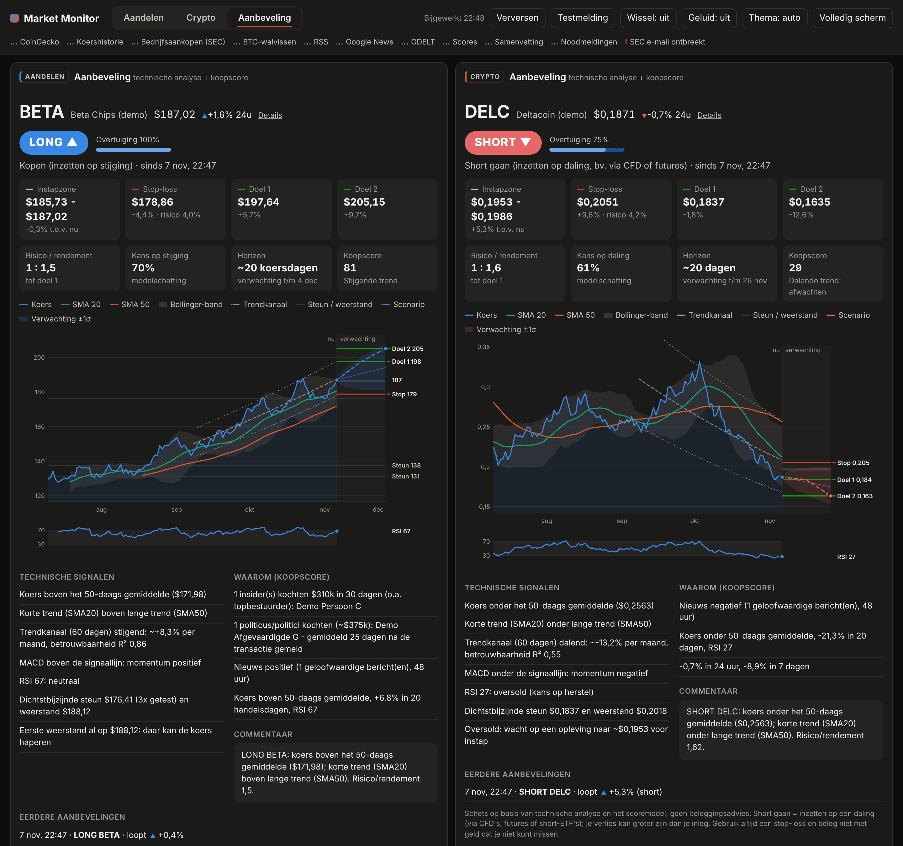
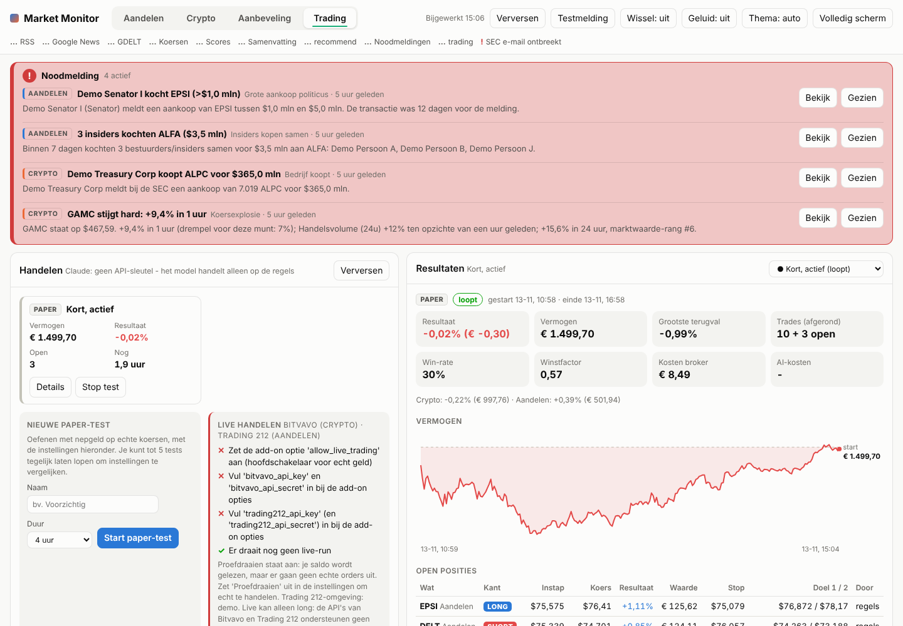
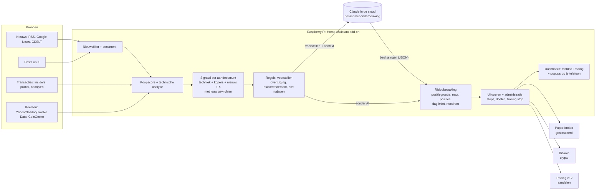

# Market Monitor (Home Assistant add-on)

Een dashboard voor je monitor dat volgt wat grote spelers doen op de **aandelenmarkt** en de **cryptomarkt**,
met een duidelijke splitsing tussen de twee (tabbladen *Aandelen* en *Crypto*).

**Aandelen**
- Transacties van **politici** (Amerikaans Congres: Huis en Senaat) en **bedrijfsinsiders** (CEO's, directeuren,
  grootaandeelhouders) uit officiële, openbare bronnen.

**Crypto**
- **Bedrijven die crypto kopen** voor hun balans (bijvoorbeeld Strategy), uit SEC-meldingen.
- **Grote bitcoin-transfers** ("walvissen").
- **Politici en insiders die crypto-ETF's of -aandelen kopen**, zoals IBIT of MSTR.

**Voor beide markten**
- **Aanbeveling met technische analyse:** het beste aandeel en de beste munt van dat moment, met de vraag of je
  moet **longen of shorten**. Op de koersgrafiek worden de analyse en de verwachting getekend.
- **Popup-meldingen op je telefoon:** elk uur een update, en direct een noodmelding als er iets belangrijks gebeurt.
- **Nieuws van het hele web** (betrouwbare media, Google News, GDELT en optioneel X), met een filter dat
  onbetrouwbare bronnen, clickbait en hype eruit haalt. Bij crypto worden ook presales en "next 100x"-promotie
  weggefilterd.
- **Elk uur een samenvatting in gewone taal:** wat er speelde, wat de grote kopers deden en wat er nu het best
  uitziet om te kopen. Optioneel geschreven door Claude (AI), ook als pushbericht. Met **Nu samenvatten** maak je
  er direct een.
- **Noodmeldingen:** als er iets groots aan lijkt te komen, krijg je meteen een alert, ook tussen de
  uurberichten door.
- Een **kooplijst** met per aandeel of munt een score (0-100), een geschatte **kans op stijging** (~1 maand) en
  een **instapmoment**.
- **Zelfstandig handelen (nieuw in 0.6):** zet een budget klaar en laat het model 24/7 zelf kopen en verkopen via
  **Bitvavo** (crypto) en **Trading 212** (aandelen), met Claude als beslisser en harde risicogrenzen. Eerst oefenen
  met **paper trading** (nepgeld, echte koersen), tests vergelijken en de instellingen bijstellen. Zie
  [Zelfstandig handelen](#zelfstandig-handelen-bitvavo--trading-212).

Het draait als add-on op **Home Assistant OS** (bijvoorbeeld op een Raspberry Pi 4 of 5) en verschijnt als paneel
in de zijbalk.






<details><summary>Crypto-tabblad en detailweergave</summary>


</details>

> **Geen beleggingsadvies.** Scores, kansen en noodmeldingen zijn modelinschattingen op basis van openbare data.
> Niemand kan betrouwbaar voorspellen dat een koers gaat stijgen. Een noodmelding betekent "hier gebeurt iets
> ongewoons", niet "dit gaat zeker omhoog". Gebruik het als startpunt voor je eigen onderzoek.

---

## Installatie op je Raspberry Pi

### Optie A: via de add-on store (aanbevolen)

1. Zorg dat deze GitHub-repository **openbaar** is. Home Assistant kan geen privé-repository's ophalen.
2. Ga in Home Assistant naar **Instellingen → Add-ons → Add-on store**.
3. Klik rechtsboven op **⋮ → Repository's** en voeg toe: `https://github.com/antoshkalol/Ai-programma-s-`
4. Ververs de pagina. Kies **Market Monitor** en klik op **Installeren**. De Pi bouwt de add-on zelf; dat duurt een
   paar minuten.
5. Vul in het tabblad **Configuratie** minimaal in:
   - **`sec_user_agent`**: je naam en e-mailadres, bijvoorbeeld `Jan Jansen jan@voorbeeld.nl`.
6. Zet **Toon in zijbalk** aan en klik op **Starten**.
7. Klik in het dashboard op **Testmelding**. Krijg je een popup op je telefoon, dan werkt alles (zie hieronder).

### Optie B: lokaal, zonder GitHub

1. Installeer de add-on **Samba share** (of **Advanced SSH & Web Terminal**).
2. Kopieer de map `market_monitor/` uit deze repository naar de gedeelde map **`addons`** op je Pi.
3. Ga naar **Add-on store → ⋮ → Controleren op updates**. De add-on staat dan onder **Lokale add-ons**.
4. Installeer en configureer hem zoals bij optie A, stap 4 t/m 6.

Na het starten verschijnen de eerste gegevens binnen een paar minuten. De eerste samenvatting komt ongeveer 5
minuten na de start, daarna elk heel uur.

---

## Meldingen op je telefoon (popups)

De meldingen gaan naar de **Home Assistant-app** op je telefoon (App Store / Google Play). Log in met je
Home Assistant en sta meldingen toe. Meer is er niet nodig:
- **Automatisch:** met `notify_service` leeg stuurt de add-on naar alle telefoons waarop de app is ingelogd.
- **Eén telefoon:** wil je maar één telefoon, vul dan bijvoorbeeld `mobile_app_iphone_van_jan` in (meerdere met
  komma's). De naam vind je bij **Ontwikkelhulpmiddelen → Acties** door `notify.mobile_app` te typen.
- **Testen:** klik in het dashboard op **Testmelding**.

| Soort | Wanneer | Hoe het binnenkomt |
|---|---|---|
| **Uurbericht** | Elk heel uur (instelbaar met `summary_interval_minutes`) | Als popup (iPhone: banner, Android: zwevende melding), met de kop en de aanbeveling per markt. Een nieuw uurbericht vervangt het vorige, zodat ze zich niet opstapelen. Met `quiet_hours: 23-7` komt er 's nachts geen uurbericht. |
| **Noodmelding** | Direct, zodra een detector afgaat (wordt elke 2 minuten gecontroleerd) | Als popup met hoge prioriteit, elke melding apart. Met `alert_critical` aan komt hij ook door stil/niet storen heen (iPhone: kritieke melding, Android: alarmgeluid). Daarnaast een melding in Home Assistant en een rode balk bovenaan het dashboard, eventueel met geluid. |

Tik op een melding of op **Open dashboard** om meteen het dashboard te openen.

**Zie je geen popup?**
- **iPhone:** controleer Instellingen → Meldingen → Home Assistant → *Stijl: Banners*. Voor kritieke meldingen
  moet je die daar eenmalig toestaan.
- **Android:** controleer Instellingen → Apps → Home Assistant → Meldingen. De kanalen *Market Monitor* en
  *Market Monitor noodmelding* moeten op *Pop-up op scherm* staan. Ze verschijnen na de eerste melding.

### Wanneer komt er een noodmelding?

| Markt | Signaal | Voorwaarde (gevoeligheid "normaal") |
|---|---|---|
| Crypto | **Koersexplosie** | Binnen 1 uur minstens +4% (BTC/ETH), +7% (top 20) of +12% (overige top 100), samen met een volumepiek. Zonder volumepiek pas bij het dubbele. |
| Crypto | **Bedrijf koopt** | Een bedrijf meldt een aankoop van meer dan $250 mln aan een munt |
| Aandelen | **Insiders kopen samen** | 3 of meer insiders kochten binnen 7 dagen hetzelfde aandeel, samen meer dan $1 mln |
| Aandelen | **Grote insider-aankoop** | Een CEO/CFO/voorzitter koopt voor meer dan $5 mln op de open markt |
| Aandelen | **Grote aankoop politicus** | Een politicus meldt een aankoop van meer dan $1 mln |
| Aandelen | **Koersuitbraak** | Een gevolgd aandeel staat meer dan 8% hoger dan het vorige slot |
| Beide | **Groot nieuws** | Positief nieuws met een concrete aanleiding (goedkeuring, ETF, overname, ...), binnen 45 minuten gemeld door minstens 3 betrouwbare bronnen |
| Beide | **Score-sprong** | De koopscore springt binnen een uur met 15 punten of meer naar 75 of hoger |

Om te voorkomen dat je telefoon blijft piepen:
- **Afkoelperiode:** hetzelfde signaal voor hetzelfde aandeel of dezelfde munt hooguit eens per 6 uur. Bij
  meerdere signalen voor dezelfde munt komt maar één melding per 2 uur.
- **Daglimiet:** maximaal `max_alerts_per_day` noodmeldingen per 24 uur (standaard 6).
- **Gevoeligheid:** `alert_sensitivity: laag` maakt alle drempels 1,5 keer strenger, `hoog` 0,7 keer zo streng
  (dus eerder een melding).
- **AI-controle:** met een API-sleutel en `ai_check_alerts` beoordeelt Claude elke noodmelding eerst. Hype, een
  los gerucht of een beweging die al achter de rug lijkt, wordt tegengehouden. Tegengehouden meldingen zie je in
  het samenvattingspaneel onder "Noodmeldingen (24 uur)". Lukt de AI-controle niet, dan gaat de melding gewoon door.

Let op: een koersexplosie wordt pas gezien als de stijging al bezig is. Een deel van de beweging kan dus al
gebeurd zijn.

---

## Aanbeveling: long of short, met technische analyse

Het tabblad **Aanbeveling** toont per markt de beste kandidaat van dat moment, met een vast plan en een live
status (zie *Hoe de aanbeveling actueel blijft* hieronder). Elk kwartier kijkt de add-on
naar de aandelen of munten met de meest uitgesproken koopscore (ver van 50, omhoog of omlaag). Daarvan wint de
kandidaat waarbij model en techniek het overtuigendst dezelfde kant op wijzen.

**Richting**
- **LONG ▲:** kopen; je verdient als de koers stijgt.
- **SHORT ▼:** inzetten op een daling, bijvoorbeeld via CFD's, futures of short-ETF's.
- **AFWACHTEN:** geen duidelijke richting.

De richting komt voor 60% uit de koopscore en voor 40% uit de technische stemming.

**Plan**
- **Instapzone.** Is het aandeel oververhit (RSI boven 70), dan raadt het plan aan te wachten op een terugval;
  bij een short op een opleving.
- **Stop-loss:** net voorbij het dichtstbijzijnde steun- of weerstandsniveau.
- **Doel 1 en doel 2:** volgende niveaus of de trendrichting.
- **Risico/rendement:** minimaal 1 : 1,2.
- **Kans:** de kans op stijging of daling.
- **Horizon:** ongeveer 20 koersdagen.

**Wat er op de grafiek staat**

| Element | Betekenis |
|---|---|
| Koers + SMA 20 + SMA 50 | Korte en langere trend |
| Grijze band | Bollinger-band (20 dagen, ±2σ): hoe ver de koers normaal uitslaat |
| Stippellijnen | Trendkanaal (regressie over 60 dagen) |
| Horizontale grijze lijnen | Steun en weerstand: niveaus die meerdere keren getest zijn |
| Grijs vlak rechts van "nu" | Instapzone |
| Rode / groene lijn | Stop-loss / koersdoelen |
| Gekleurde kegel | Verwachte bandbreedte (±1σ) voor de komende ~20 dagen |
| Gestippelde lijn met punt | Het scenario richting doel 1 en doel 2 |
| Strook onder de grafiek | RSI (boven 70 oververhit, onder 30 oversold) |

Daaronder staan de technische signalen (trend, MACD, RSI, Bollinger, steun/weerstand) en de redenen achter de
koopscore. Met een API-sleutel geeft Claude elk uur commentaar: steunen nieuws en transacties de richting, en wat
is het grootste risico? Eerdere aanbevelingen worden bewaard, met hun resultaat ("doel 1 gehaald",
"stop geraakt" of "loopt").

De aanbeveling staat ook in het uurbericht op je telefoon en in de sensor
`sensor.market_monitor_<markt>_recommendation`.

### Hoe de aanbeveling actueel blijft

Instap, stop-loss en doelen staan vast zolang het plan geldt; zo zie je of het plan uitkomt. Elke **3 minuten**
wordt het plan tegen de actuele koers gehouden.

| Situatie | Wat er gebeurt |
|---|---|
| Koers in de instapzone | Status: "instappen kan nu" |
| Koers ver boven/onder de instapzone | Status: "niet najagen, wacht op een terugval/opleving" |
| **Doel 1 gehaald** | Stop gaat naar de instapprijs (winst veiligstellen), popup |
| **Doel 2 gehaald** of **stop-loss geraakt** | Plan wordt gesloten en een nieuwe aanbeveling uitgegeven, popup. Na een geraakte stop wordt dezelfde kant van dat aandeel of die munt 24 uur niet opnieuw aanbevolen. |
| Koopscore + techniek slaan om (bv. long → short) | Nieuw plan, popup |
| Andere kandidaat duidelijk sterker (≥ 30% en het plan is minstens een uur oud) | Wisselen, popup |
| 24 uur buiten de instapzone | Instap, stop en doelen bijgewerkt naar de huidige koers, popup |

Wijzigingspopups komen hooguit eens per 30 minuten per markt; stop en doelen komen altijd direct. Uitzetten kan met
`notify_recommendation_changes: false`. De koersen die hiervoor gebruikt worden, zijn voor crypto elke 3 minuten
vers en voor aandelen elk kwartier tijdens beurstijd.

> Shorten is riskanter dan kopen: je verlies kan groter zijn dan je inleg. Technische analyse is een
> hulpmiddel, geen glazen bol. Gebruik altijd een stop-loss.

---

## Zelfstandig handelen (Bitvavo + Trading 212)

Op het tabblad **Trading** zet je een budget klaar. Het model zoekt dan 24/7 naar de beste kansen in aandelen en
crypto, beslist zelf wat het koopt of verkoopt, hoeveel en wanneer, en voert de orders uit. Je hoeft niets te
bevestigen. Het volgt daarvoor drie dingen:

- **de techniek:** trend, momentum (MACD, RSI), steun en weerstand;
- **het nieuws en de posts op X** van de accounts die je volgt;
- **de grote kopers:** insiders, politici en bedrijven die crypto kopen.

> **Echt geld, echt risico.** Ook met een slim model kun je (een deel van) je inleg verliezen. Een paper-test van
> een paar uur zegt weinig over de toekomst. Begin klein, met geld dat je kunt missen. Dit is geen beleggingsadvies.

### Het schema



### Hoe het werkt

**Elke minuut, voor elke actieve run (paper-tests en de live-run):**
1. De posities worden gewaardeerd tegen de actuele koers, in euro (met de ECB-wisselkoers).
2. Stops, doelen, de trailing stop en de maximale looptijd worden gecontroleerd:
   - stop-loss geraakt → positie sluiten;
   - doel 1 gehaald → een deel verkopen (standaard 50%) en de stop naar de instapprijs plus kosten;
   - daarna schuift de stop mee met de koers (trailing stop);
   - doel 2 gehaald → alles verkopen.
3. **Risicobewaking:**
   - bij het maximale dagverlies komen er die dag geen nieuwe posities meer bij;
   - bij de maximale terugval vanaf de hoogste stand stopt de run helemaal (noodrem, met een kritieke melding).

**Elke 15 minuten (instelbaar), en direct bij groot nieuws:**
1. **Signaal per aandeel/munt:** de sterkste kandidaten krijgen een score van -1 (sterk dalen) tot +1 (sterk
   stijgen). Daarin tellen techniek, grote kopers, nieuws en X mee, met de gewichten die jij kiest.
2. **De regels doen voorstellen:** voldoende overtuiging, de techniek wijst niet de andere kant op, de koers is
   niet al weggelopen ("niet najagen") en het risico/rendement is minstens 1,5.
3. **Claude beslist:** per voorstel en per open positie, met een onderbouwing. Claude krijgt daarvoor:
   - de signalen, de technische analyse, de nieuwskoppen en X-posts;
   - de noodmeldingen, je portefeuille en de recente trades;
   - zijn eigen marktvisie van de vorige keer.

   In de modus *vrij* mag Claude ook zelf een kandidaat kiezen. Alles staat met de reden in het **logboek**.
4. **De code bewaakt altijd de grenzen,** wat Claude ook zegt:
   - alleen aandelen/munten uit de kandidatenlijst;
   - positiegrootte volgens jouw risico per trade;
   - maximale positie, blootstelling, aantal posities en trades per dag;
   - geen short als dat niet mag;
   - geen handel op een verouderde koers;
   - aandelen alleen tijdens beurstijd.
5. Uitvoeren bij de broker (of in de simulatie) en een popup op je telefoon.

**Positiegrootte:** het risico per trade (standaard 1% van je budget) gedeeld door de afstand tot de stop-loss.
Een ruime stop geeft dus een kleinere positie. Bij lagere overtuiging of een kleinere `size_factor` van Claude
wordt de positie kleiner. Nooit groter dan de maximale positie (standaard 25%).

**Zonder AI-sleutel** of als Claude niet bereikbaar is, handelt het model alleen op de regels. Dat staat dan ook
in het logboek.

### Short gaan: alleen in paper trading

Live kan het model **alleen long** (kopen en verkopen):
- **Trading 212:** de API werkt alleen voor het Invest-account (en ISA). Short gaan kan alleen in het
  CFD-account, en daar is geen API voor.
- **Bitvavo:** short gaan (marge) kan sinds 2026 in de app, maar niet via de API.

Een short-signaal betekent live dus: een longpositie in dat aandeel of die munt sluiten, of niet instappen. In
paper trading kun je shorten wel simuleren (`allow_short`). Wil je later echt shorten, dan is een broker met
margehandel of futures via een API nodig, zoals Interactive Brokers of Kraken. Dat zit nog niet in de add-on.

### Stappenplan

1. **Instellingen.** Kies op het tabblad Trading je budgetten en je risico (zie de uitleg bij elk veld) en klik op
   **Opslaan**.
2. **Paper-tests.** Start een paper-test van bijvoorbeeld 4 uur. Start er gerust een paar tegelijk met
   verschillende instellingen (maximaal 5), bijvoorbeeld:
   - stijl *kort* tegenover *swing*;
   - een hogere minimale overtuiging;
   - een ander gewicht voor nieuws.
3. **Vergelijken.** De tabel *Tests vergelijken* toont per test het resultaat, de grootste terugval, de win-rate,
   de winstfactor en de kosten. Klik een test aan voor de grafiek, de trades en het logboek, en kies **Instellingen
   van deze run overnemen** voor de beste. Een paar uur is vooral een functietest. Laat de beste instellingen
   daarna minstens een paar dagen tot weken lopen voordat je conclusies trekt.
4. **Accounts en sleutels** (zie hieronder). Zet `allow_live_trading` aan.
5. **Proefdraaien.** Start live met **Proefdraaien** aan:
   - je saldo wordt echt gelezen, maar orders worden alleen gelogd;
   - test eerst met **Verbinding testen**;
   - voor Trading 212 kun je ook de demo-omgeving gebruiken (oefenaccount met nepgeld bij Trading 212 zelf).
6. **Klein beginnen.** Zet Proefdraaien uit, kies een klein budget en typ `IK BEGRIJP HET RISICO` om te starten.
   Stoppen kan altijd: **Stop en sluit alles** of **Stop, laat posities staan**.

### Accounts en API-sleutels

**Bitvavo (crypto, Nederlands, MiCA-vergunning bij de AFM):**
1. Ga naar *Instellingen → API* en maak een sleutel aan met **alleen** de rechten *Bekijken* en *Handelen*.
   Geef **nooit** het recht *Opnemen*.
2. Zet een IP-whitelist aan met het (vaste) IP-adres van je thuisverbinding.
3. Vul `bitvavo_api_key` en `bitvavo_api_secret` in bij de add-on opties.

Het model handelt in euromarkten (BTC-EUR enz.) met marktorders. Elke cryptopositie krijgt ook een
**stop-loss-order op Bitvavo zelf**. Zo ben je beschermd als de Pi uitvalt.

**Trading 212 (aandelen):**
1. Gebruik een **Invest**-account. Ga naar *Instellingen → API (bèta)* en maak een sleutel aan. Je krijgt een
   sleutel en een geheim.
2. Zet een IP-beperking aan.
3. Vul `trading212_api_key` en `trading212_api_secret` in. Kies op het tabblad Trading de omgeving: `demo` of
   `live`. De sleutel moet uit dezelfde omgeving komen.

Via de API zijn alleen marktorders mogelijk. De stop-loss bewaakt de Pi zelf, alleen tijdens beurstijd (15:30-22:00
Nederlandse tijd). Valt de Pi uit, dan is er voor aandelen geen stop.

### Claude instellen

De Raspberry Pi is te licht om zelf een AI-model te draaien. Dat hoeft ook niet: **Claude draait in de cloud van
Anthropic.** De Pi stuurt per beslismoment een verzoek met de gegevens (JSON) en krijgt de beslissingen terug.

1. Maak een account op [console.anthropic.com](https://console.anthropic.com).
2. Zet bij *Billing* tegoed op je account (bijvoorbeeld $20) en eventueel een maandlimiet.
3. Maak bij *API keys* een sleutel aan en vul die in bij de add-on optie `anthropic_api_key`. Dezelfde sleutel
   wordt gebruikt voor de samenvattingen en de controle van noodmeldingen.
4. Kies op het tabblad Trading het model, het denkniveau, hoe vaak Claude maximaal beslist en het maximum aantal
   aanroepen per dag.

**Wat kost het?** Een beslissing is ongeveer 10.000 tokens invoer en 2.500 tokens uitvoer (inclusief nadenken).
Met 15 minuten tussen de beslissingen en het standaardmaximum van 100 aanroepen per run per dag:

| Model | Prijs per miljoen tokens (in/uit) | Per beslissing | Per run per dag (max. 100) |
|---|---|---|---|
| `claude-opus-5-5` (standaard, slimst) | $4 / $20 | ~$0,09 | ~$9 |
| `claude-sonnet-5-5` | $2 / $10 | ~$0,045 | ~$4,50 |
| `claude-haiku-5-5` (goedkoopst) | $0,10 / $0,50 | ~$0,002 | ~$0,25 |

Elke paper-test met AI kost apart. Draai je vijf tests tegelijk, dan kost het ook vijf keer zoveel. Je kunt het
verlagen met:
- een goedkoper model voor de paper-tests;
- een langer interval (`ai_min_interval_minutes`);
- een lager `ai_max_calls_per_day`.

Het dashboard toont per run de **werkelijke** AI-kosten, berekend uit de tokens die de API teruggeeft.

### Veiligheid

- **Hoofdschakelaar:** live handelen kan alleen met de add-on optie `allow_live_trading` aan. Zonder die optie kan
  niemand via het dashboard live handelen.
- **Live starten** vraagt een bevestiging (`IK BEGRIJP HET RISICO`), tenzij je proefdraait.
- **API-sleutels:** zonder opnamerechten en met een IP-whitelist. De add-on bewaart ze alleen in de add-on opties
  en toont ze nergens.
- **Eigen administratie:** het model verkoopt alleen wat het zelf gekocht heeft, nooit je andere beleggingen. Het
  gebruikt nooit meer dan het budget (en het vrije saldo bij de broker).
- **Geen dubbele orders:** een order wordt nooit automatisch opnieuw verstuurd. Is het onzeker of een order is
  uitgevoerd (bijvoorbeeld bij een time-out), dan stopt de run en krijg je een melding om je account te
  controleren.
- **Noodrem en daglimiet** met een kritieke popup op je telefoon.

### Belangrijkste instellingen

| Instelling | Standaard | Wat het doet |
|---|---|---|
| Budget aandelen / crypto | €1.000 / €1.000 | Maximaal in te zetten bedrag per broker (0 = die markt niet verhandelen). |
| Risico per trade | 1% | Verlies als de stop-loss geraakt wordt; bepaalt de positiegrootte. |
| Maximale positie | 25% | Maximaal deel van het budget in één aandeel of munt. |
| Maximale blootstelling (marge) | 100% | Boven 100% = met hefboom; alleen in paper trading. |
| Maximaal verlies per dag | 4% | Daarna die dag geen nieuwe posities. |
| Noodrem | 15% | Terugval vanaf de hoogste stand waarbij de run stopt. |
| Handelsstijl | swing | *swing* = dagen tot weken; *kort* = uren tot dagen (krappere stops). |
| Minimale overtuiging / risico-rendement | 35 / 1,5 | Hoe streng de regels zijn. |
| Gewichten techniek/kopers/nieuws/X | 40/25/20/15 | Waar het signaal op let. |
| Shorten toestaan | aan | Alleen in paper trading (zie hierboven). |
| AI: vrijheid / model / interval | vrij / Opus 5.5 / 15 min | Hoeveel Claude zelf mag, welk model en hoe vaak. |
| Kosten en slippage | 0,25% / 0,15% / 0,10% | Voor een realistische paper-simulatie. |
| Proefdraaien | aan | Live zonder echte orders. |

Alle instellingen staan met uitleg en grenzen in het dashboard. Een test krijgt bij de start een kopie, zodat je
tests met verschillende instellingen kunt vergelijken.

---

## Configuratie

**Algemeen en meldingen**

| Optie | Uitleg |
|---|---|
| `sec_user_agent` | **Verplicht** voor SEC-data (insiders en crypto-bedrijfsaankopen). Je naam en e-mailadres. Gaat alleen naar sec.gov. |
| `notify_service` | Leeg = automatisch alle telefoons met de Home Assistant-app; of zelf invullen, zie hierboven. |
| `notify_summaries` | Het uurbericht als popup sturen (standaard aan). |
| `notify_recommendation_changes` | Popup als de aanbeveling wijzigt: stop of doel geraakt, richting omgeslagen, andere kandidaat (standaard aan). |
| `quiet_hours` | Bijvoorbeeld `23-7`: dan geen uurbericht tussen 23:00 en 07:00 (noodmeldingen komen wel). Leeg = altijd. |
| `alerts_enabled`, `alert_sensitivity`, `alert_critical`, `ai_check_alerts`, `max_alerts_per_day` | Instellingen van de noodmeldingen (zie hierboven). |
| `anthropic_api_key` | Optioneel. Sleutel van [console.anthropic.com](https://console.anthropic.com) voor AI-samenvattingen en de AI-controle. Zonder sleutel krijg je een automatische samenvatting (gratis). |
| `stock_price_api_key` | Optioneel: een gratis sleutel van [twelvedata.com](https://twelvedata.com) voor betrouwbare aandelenkoersen. Aanrader als de aandelen-aanbeveling of koersen ontbreken. |
| `anthropic_model`, `anthropic_effort` | Het Claude-model en hoe grondig het nadenkt. Standaard `claude-opus-5-5` en `medium`. |
| `summary_interval_minutes` | Hoe vaak de samenvatting komt; standaard 60. |
| `allow_live_trading` | Hoofdschakelaar voor live handelen met echt geld (standaard uit: alleen paper trading). |
| `bitvavo_api_key`, `bitvavo_api_secret` | Sleutel van Bitvavo, alleen met de rechten bekijken en handelen. |
| `trading212_api_key`, `trading212_api_secret` | Sleutel van Trading 212 (Invest-account, demo of live). |

De overige handelsinstellingen (budget, risico, AI, ...) stel je in op het tabblad **Trading**.

**Aandelen:** `enable_stocks`, `stock_watchlist`, `stock_news_queries`, `stock_x_accounts`, `enable_sec_form4`,
`enable_house`, `enable_senate`, `quiver_api_key` (optioneel, betaald), `min_trade_value_usd`, `big_trade_alert_usd`.

**Crypto:** `enable_crypto`, `crypto_watchlist` (bijvoorbeeld BTC, ETH, SOL), `crypto_news_queries`,
`crypto_x_accounts`, `enable_crypto_treasury`, `enable_btc_whales`, `crypto_whale_min_usd` (standaard $50 mln),
`coingecko_api_key` (optioneel, gratis demo-sleutel van coingecko.com voor ruimere limieten).

**Nieuws:** `enable_rss`, `enable_google_news`, `enable_gdelt`, `extra_rss_feeds`, `extra_crypto_rss_feeds`,
`trusted_domains`, `blocked_domains`, `min_news_credibility`, `x_bearer_token` (optioneel, betaald).

### Wat kost de AI?

Zonder API-sleutel kost de add-on niets. Met een sleutel betaal je Anthropic per gebruik. Een ruwe schatting bij
een samenvatting per uur voor beide markten (48 per dag, elk ongeveer 6.000 tokens invoer en 2.500 tokens
uitvoer). De AI-controle van een noodmelding is klein en zeldzaam.

| Model | Prijs per miljoen tokens (in/uit) | Ongeveer per maand |
|---|---|---|
| `claude-opus-5-5` (standaard) | $4 / $20 | $100 |
| `claude-sonnet-5-5` | $2 / $10 | $55 |
| `claude-haiku-5-5` | $0,10 / $0,50 | $3 |

Je kunt het verlagen met `claude-haiku-5-5`, `anthropic_effort: low`, een langer interval, of door één markt uit te
zetten.

---

## Databronnen

| Bron | Markt | Wat | Vertraging | Kosten |
|---|---|---|---|---|
| SEC EDGAR (Form 4) | Aandelen | Aan- en verkopen door bestuurders, directeuren en aandeelhouders met meer dan 10% | Melding binnen 2 werkdagen | Gratis |
| Huis van Afgevaardigden (Clerk) | Aandelen | Transacties van Afgevaardigden (PDF-meldingen) | Tot 45 dagen | Gratis |
| Senaat (eFD) | Aandelen | Transacties van Senatoren | Tot 45 dagen | Gratis (voorwaarden: niet commercieel) |
| Quiver Quantitative | Aandelen | Congres-transacties incl. partij | Idem | Betaald, optioneel |
| Twelve Data / Yahoo Finance / Nasdaq / Stooq | Aandelen | Dagkoersen, in die volgorde (Twelve Data alleen met gratis sleutel) | Ongeveer 15 minuten | Gratis |
| SEC full-text search (8-K) | Crypto | Bedrijven die BTC/ETH/SOL kopen of verkopen voor hun balans | Dagen | Gratis |
| blockchain.info | Crypto | Grote bitcoin-transfers uit nieuwe blokken | Ongeveer 10 minuten | Gratis |
| CoinGecko | Crypto | Koers, 1u/24u/7d-verandering, volume en marktwaarde van de top 100, plus koershistorie | Minuten | Gratis (optioneel gratis demo-sleutel) |
| RSS-feeds | Beide | Aandelen: MarketWatch, WSJ, CNBC, BBC, FT, Fed, SEC, NOS. Crypto: CoinDesk, The Block, Blockworks, Decrypt, DL News e.a. | Minuten | Gratis |
| Google News | Beide | Koppen van alle grote media, ook Reuters en Bloomberg | Minuten | Gratis |
| GDELT | Beide | Monitort nieuws wereldwijd | Ongeveer 15 minuten | Gratis |
| X API | Beide | Posts van accounts die jij kiest | Minuten | Betaald, optioneel |

**Goed om te weten:**
- Transacties van politici zie je nooit live. Het dashboard toont daarom bij elke transactie de **vertraging** in
  dagen.
- Een grote crypto-transfer zegt niets over de richting. Vaak zijn het interne verschuivingen van beurzen. Die
  transfers worden wel getoond, maar tellen niet mee in de score.

---

## Hoe het werkt

### Het nieuwsfilter

Elk bericht krijgt een **geloofwaardigheidsscore**, opgebouwd uit vier onderdelen:
1. **Betrouwbaarheid van de bron:** een lijst van ruim 80 domeinen, zoals Reuters 0,95, CoinDesk 0,75 en onbekende
   sites 0,35.
2. **Clickbait-straf:** voor hype-taal zoals "to the moon", "1000%", "presale", "price prediction", veel hoofdletters
   of uitroeptekens.
3. **Bevestiging:** als meerdere onafhankelijke bronnen hetzelfde verhaal melden, stijgt de score.
4. **AI-controle (optioneel):** Claude markeert elk uur ook geruchten en promotie.

Weggefilterde berichten bekijk je met de knop **Weggefilterd**.

### De koopscore (0-100)

| Aandelen | Gewicht | | Crypto | Gewicht |
|---|---|---|---|---|
| Insiders (open-markt aankopen, extra gewicht bij meerdere kopers of de CEO/CFO) | 30% | | Instituties (bedrijfsaankopen uit 8-K's; politici/insiders die crypto-ETF's kopen) | 25% |
| Politici (met straf voor late melding) | 20% | | Nieuws | 35% |
| Nieuws (geloofwaardige berichten, 48 uur) | 25% | | Koers (crypto beweegt sterk op momentum) | 40% |
| Koers (trend t.o.v. 50-daags gemiddelde, momentum, RSI) | 25% | | | |

50 is neutraal. Het dashboard toont daarnaast het **instapmoment**:
- **Gunstig:** een terugval binnen een stijgende trend.
- **Oververhit:** RSI boven 72; wacht dan op een terugval.
- **Dalende trend:** afwachten.

### Kans op stijging

De kans is eerst een **modelschatting** op basis van de score, begrensd tussen 25% en 80%. De add-on meet daarna
per markt hoe vaak eerdere scores uitkwamen. Zodra er per scoreband minstens 30 metingen zijn (na grofweg 1 à 2
maanden draaien), wordt de kans **gekalibreerd** op die echte resultaten.

---

## Home Assistant

### Sensoren

| Entiteit | Status | Belangrijkste attributen |
|---|---|---|
| `sensor.market_monitor_stocks_top_pick` / `..._crypto_top_pick` | Hoogste koopscore | `score`, `kans_omhoog`, `instapmoment`, `redenen`, `top5` |
| `sensor.market_monitor_stocks_summary` / `..._crypto_summary` | Kop van de laatste samenvatting | `kernpunten`, `transacties`, `koopvisie`, `let_op`, `stemming`, `tekst` |
| `sensor.market_monitor_stocks_last_big_trade` / `..._crypto_last_big_trade` | Laatste grote transactie | `actor_name`, `ticker`, `tx_type`, `value_usd`, `url` |
| `sensor.market_monitor_stocks_recommendation` / `..._crypto_recommendation` | Bijv. `LONG NVDA` of `AFWACHTEN (BTC)` | `entry_low`, `entry_high`, `stop`, `target1`, `target2`, `rr`, `prob`, `conviction`, `signals` |
| `sensor.market_monitor_alert` | Laatste noodmelding | `market`, `asset`, `kind`, `message`, `ai_note` |
| `sensor.market_monitor_status` | `ok` of `fout` | `bronnen_met_fouten` |
| `sensor.market_monitor_trading` | Vermogen van de live-run in euro, of `geen live-run` | `live_resultaat_pct`, `live_open_posities`, `runs` |

### Events

- `market_monitor_alert`: bij elke noodmelding.
- `market_monitor_summary`: bij elke nieuwe samenvatting (met `market`).
- `market_monitor_big_trade`: bij elke nieuwe transactie boven `big_trade_alert_usd`.

Pushberichten werken zonder automatisering. Met de events kun je meer doen,
bijvoorbeeld een lamp laten knipperen bij een noodmelding:

```yaml
alias: Lamp knippert bij noodmelding
triggers:
  - trigger: event
    event_type: market_monitor_alert
actions:
  - action: light.turn_on
    target:
      entity_id: light.bureau
    data:
      flash: long
      color_name: red
```

### Samenvatting als kaart op je dashboard

```yaml
type: markdown
title: Markt (laatste uur)
content: |
  **Aandelen:** {{ states('sensor.market_monitor_stocks_summary') }}
  **Crypto:** {{ states('sensor.market_monitor_crypto_summary') }}

  Beste kans: **{{ states('sensor.market_monitor_stocks_top_pick') }}**
  (score {{ state_attr('sensor.market_monitor_stocks_top_pick', 'score') }}) en
  **{{ states('sensor.market_monitor_crypto_top_pick') }}**
  (score {{ state_attr('sensor.market_monitor_crypto_top_pick', 'score') }})
```

### Op een aparte monitor

- Open het paneel **Market Monitor** en klik op **Volledig scherm**.
- Zet **Wissel** aan om automatisch elke 45 seconden te wisselen tussen aandelen, crypto en de aanbeveling.
- Zet **Geluid** aan voor een pieptoon bij een noodmelding. De browser vraagt hiervoor eenmalig een klik.
- Zonder inloggen: zet in het tabblad **Netwerk** van de add-on een poort open (bijvoorbeeld 8099) en open
  `http://<ip-van-je-pi>:8099#rotate`.
  Let op: iedereen in je thuisnetwerk kan het dashboard dan zien. Er staan geen sleutels in.

---

## Beperkingen

- **Niet live getest:** de koppelingen met de bronnen zijn gebouwd op hun gedocumenteerde formaten en getest met
  voorbeeldbestanden. Werkt een bron niet, dan zie je dat bovenin aan een **✕**; beweeg erover voor de foutmelding.
  Het logboek van de add-on toont ook de fout.
- **Gescande meldingen:** papieren (gescande) meldingen van politici zijn niet automatisch leesbaar. Ze
  verschijnen met een link naar de PDF.
- **Gratis bronnen zonder garantie:**
  - Yahoo Finance heeft geen officiële gratis API en weigert soms verzoeken; Nasdaq en Stooq zijn dan de reserve.
    Komen er geen aandelenkoersen binnen (✕ bij "Koersen"), vul dan een gratis Twelve Data-sleutel in
    (`stock_price_api_key`).
  - CoinGecko heeft zonder sleutel een lage limiet; met de gratis demo-sleutel gaat het ruimer.
- **Senaat:** de website van de Senaat staat alleen niet-commercieel gebruik van de data toe.
- **Handelen:**
  - de koppelingen met Bitvavo en Trading 212 zijn gebouwd volgens hun documentatie en getest met nagebootste
    antwoorden, nog niet tegen de echte API's. Begin daarom met **Verbinding testen** en **Proefdraaien**.
  - De API van Trading 212 is in bèta. De uitvoeringsprijs wordt uitgelezen als de API die teruggeeft; anders
    rekent de administratie met de laatste koers.
  - De technische analyse gebruikt dagkoersen. Aandelenkoersen komen tijdens beurstijd elk kwartier binnen,
    cryptokoersen elke 3 minuten. Stops worden daarom met die vertraging gecontroleerd.
  - Amerikaanse feestdagen worden niet herkend; de broker weigert dan de order.

## Ideeën voor later

- Nederlandse/Europese insidertransacties (AFM-register "transacties leidinggevenden").
- Kwartaalposities van grote fondsen (13F, bijvoorbeeld Berkshire Hathaway).
- In- en uitstroom van crypto-ETF's en beurzen.
- Backtest op historische data voor een snellere kalibratie.

---

## Ontwikkelen en testen

```bash
cd market_monitor/app
python -m venv .venv && . .venv/bin/activate
pip install -r requirements.txt pytest
python -m pytest -q                            # alle tests
python scripts/demo_seed.py ./devdata          # fictieve demodata (beide markten + noodmeldingen)
python -m market_monitor --data-dir ./devdata --port 8099 --no-scheduler
# open http://localhost:8099  (of #crypto / #rotate)
```

Zonder `--no-scheduler` haalt de app echte data op. Opties zet je in `./devdata/options.json`, met dezelfde namen
als in de add-on.

### Projectstructuur

```
repository.yaml                 Home Assistant add-on repository
market_monitor/                 de add-on
  config.yaml, build.yaml       add-on definitie (opties, ingress, architecturen)
  Dockerfile, run.sh            container
  translations/                 namen en uitleg van de opties (nl/en)
  app/market_monitor/
    sources/                    SEC, Huis, Senaat, Quiver, koersen | CoinGecko, BTC-walvissen, SEC 8-K | nieuws, X
    filtering.py                nieuwsfilter (betrouwbaarheid, clickbait, bevestiging)
    tickers.py, sentiment.py    aandelen en munten herkennen, sentiment
    scoring.py                  koopscore aandelen en crypto, kans, instapmoment, kalibratie
    technical.py, recommend.py  technische analyse en aanbeveling (long/short, instap, stop, doelen)
    summary.py                  samenvatting per markt (Claude of automatisch)
    alerts.py                   noodmeldingen (detectoren, afkoelperiode, daglimiet, AI-controle)
    hass.py                     sensoren, events en popup-meldingen naar je telefoon
    trading/                    zelfstandig handelen:
      settings.py               alle instelbare variabelen (grenzen, uitleg)
      signals.py                signaal per aandeel/munt + stop/doelen
      engine.py                 de motor: risico, positiegrootte, stops, beslissen, administratie
      ai.py                     Claude als beslisser (gestructureerde JSON, kostenteller)
      brokers.py                paper-simulatie, Bitvavo (HMAC), Trading 212 (Basic auth)
      fx.py                     euro/dollar via de ECB
    web.py, static/             dashboard en API
  app/tests/                    tests met voorbeeldbestanden
```
