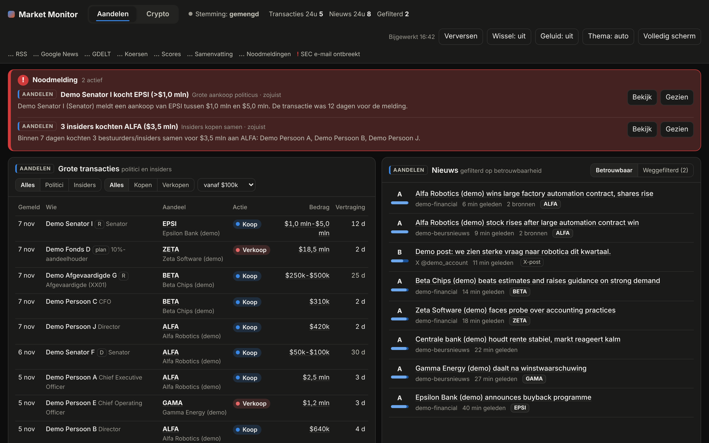
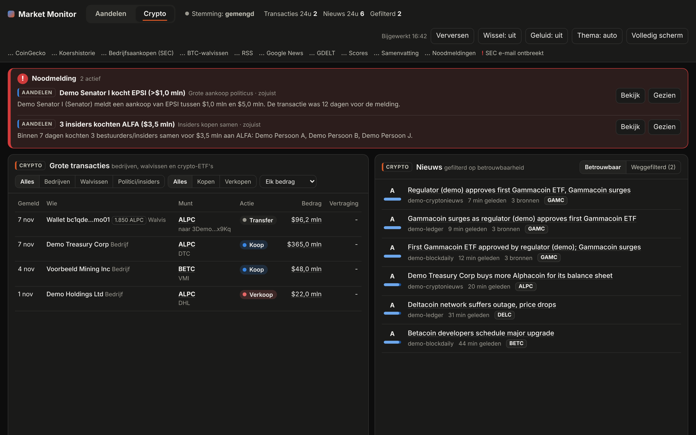
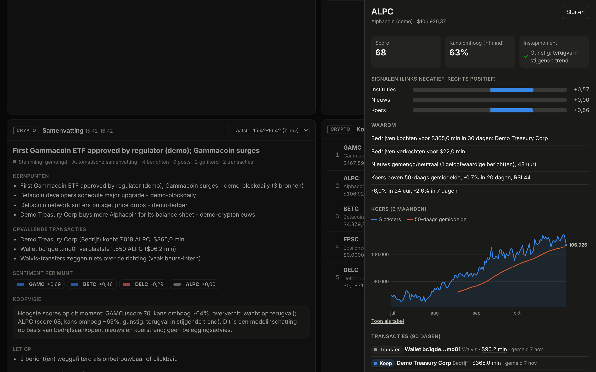

# Market Monitor (Home Assistant add-on)

Een dashboard voor je monitor dat volgt wat grote spelers doen op de **aandelenmarkt** en de **cryptomarkt**,
met een duidelijke splitsing tussen de twee (tabbladen *Aandelen* en *Crypto*).

**Aandelen**
- Transacties van **politici** (Amerikaans Congres: Huis en Senaat) en **bedrijfsinsiders** (CEO's, directeuren,
  grootaandeelhouders) uit officiële, openbare bronnen.

**Crypto**
- **Bedrijven die crypto kopen** voor hun balans (bijvoorbeeld Strategy), uit SEC-meldingen.
- **Grote bitcoin-transfers** ("walvissen").
- **Politici en insiders die crypto-ETF's of -aandelen kopen**, zoals IBIT of MSTR.

**Voor beide markten**
- **Nieuws van het hele web** (betrouwbare media, Google News, GDELT en optioneel X), met een filter dat
  onbetrouwbare bronnen, clickbait en hype eruit haalt. Bij crypto worden ook presales en "next 100x"-promotie
  weggefilterd.
- **Elk uur een samenvatting**, optioneel geschreven door Claude (AI), als pushbericht op je telefoon.
- **Noodmeldingen:** als er iets groots aan lijkt te komen, krijg je meteen een alert, ook tussen de
  uurberichten door.
- Een **kooplijst** met per aandeel of munt een score (0-100), een geschatte **kans op stijging** (~1 maand) en
  een **instapmoment**.

Het draait als add-on op **Home Assistant OS** (bijvoorbeeld op een Raspberry Pi 4 of 5) en verschijnt als paneel
in de zijbalk.



<details><summary>Crypto-tabblad en detailweergave</summary>




</details>

> **Geen beleggingsadvies.** Scores, kansen en noodmeldingen zijn modelinschattingen op basis van openbare data.
> Niemand kan betrouwbaar voorspellen dat een koers gaat stijgen. Een noodmelding betekent "hier gebeurt iets
> ongewoons", niet "dit gaat zeker omhoog". Gebruik het als startpunt voor je eigen onderzoek.

---

## Installatie op je Raspberry Pi

### Optie A: via de add-on store (aanbevolen)

1. Zorg dat deze GitHub-repository **openbaar** is. Home Assistant kan geen privé-repository's ophalen.
2. Ga in Home Assistant naar **Instellingen → Add-ons → Add-on store**.
3. Klik rechtsboven op **⋮ → Repository's** en voeg toe: `https://github.com/antoshkalol/Ai-programma-s-`
4. Ververs de pagina. Kies **Market Monitor** en klik op **Installeren**. De Pi bouwt de add-on zelf; dat duurt een
   paar minuten.
5. Vul in het tabblad **Configuratie** minimaal in:
   - **`sec_user_agent`**: je naam en e-mailadres, bijvoorbeeld `Jan Jansen jan@voorbeeld.nl`.
   - **`notify_service`**: de notify-service van je telefoon, bijvoorbeeld `mobile_app_iphone_van_jan`. Daarmee
     komen de uurberichten en noodmeldingen op je telefoon. De naam vind je bij **Ontwikkelhulpmiddelen → Acties**
     door `notify.` te typen. Hiervoor moet de Home Assistant-app op je telefoon staan.
6. Zet **Toon in zijbalk** aan en klik op **Starten**.

### Optie B: lokaal, zonder GitHub

1. Installeer de add-on **Samba share** (of **Advanced SSH & Web Terminal**).
2. Kopieer de map `market_monitor/` uit deze repository naar de gedeelde map **`addons`** op je Pi.
3. Ga naar **Add-on store → ⋮ → Controleren op updates**. De add-on staat dan onder **Lokale add-ons**.
4. Installeer en configureer hem zoals bij optie A, stap 4 t/m 6.

Na het starten verschijnen de eerste gegevens binnen een paar minuten. De eerste samenvatting komt ongeveer 5
minuten na de start, daarna elk heel uur.

---

## Meldingen

| Soort | Wanneer | Hoe |
|---|---|---|
| **Uurbericht** | Elk heel uur (instelbaar met `summary_interval_minutes`) | Eén gewoon pushbericht met de kop van beide markten en de beste kans per markt |
| **Noodmelding** | Direct, zodra een detector afgaat (wordt elke 2 minuten gecontroleerd) | Pushbericht met hoge prioriteit. Met `alert_critical` aan komt het ook door stil/niet storen heen (iPhone: kritieke melding, Android: alarmgeluid). Daarnaast een melding in Home Assistant en een rode balk bovenaan het dashboard, eventueel met geluid. |

### Wanneer komt er een noodmelding?

| Markt | Signaal | Voorwaarde (gevoeligheid "normaal") |
|---|---|---|
| Crypto | **Koersexplosie** | Binnen 1 uur minstens +4% (BTC/ETH), +7% (top 20) of +12% (overige top 100), samen met een volumepiek. Zonder volumepiek pas bij het dubbele. |
| Crypto | **Bedrijf koopt** | Een bedrijf meldt een aankoop van meer dan $250 mln aan een munt |
| Aandelen | **Insiders kopen samen** | 3 of meer insiders kochten binnen 7 dagen hetzelfde aandeel, samen meer dan $1 mln |
| Aandelen | **Grote insider-aankoop** | Een CEO/CFO/voorzitter koopt voor meer dan $5 mln op de open markt |
| Aandelen | **Grote aankoop politicus** | Een politicus meldt een aankoop van meer dan $1 mln |
| Aandelen | **Koersuitbraak** | Een gevolgd aandeel staat meer dan 8% hoger dan het vorige slot |
| Beide | **Groot nieuws** | Positief nieuws met een concrete aanleiding (goedkeuring, ETF, overname, ...), binnen 45 minuten gemeld door minstens 3 betrouwbare bronnen |
| Beide | **Score-sprong** | De koopscore springt binnen een uur met 15 punten of meer naar 75 of hoger |

Om te voorkomen dat je telefoon blijft piepen:
- **Afkoelperiode:** hetzelfde signaal voor hetzelfde aandeel of dezelfde munt hooguit eens per 6 uur. Bij
  meerdere signalen voor dezelfde munt komt maar één melding per 2 uur.
- **Daglimiet:** maximaal `max_alerts_per_day` noodmeldingen per 24 uur (standaard 6).
- **Gevoeligheid:** `alert_sensitivity: laag` maakt alle drempels 1,5 keer strenger, `hoog` 0,7 keer zo streng
  (dus eerder een melding).
- **AI-controle:** met een API-sleutel en `ai_check_alerts` beoordeelt Claude elke noodmelding eerst. Hype, een
  los gerucht of een beweging die al achter de rug lijkt, wordt tegengehouden. Tegengehouden meldingen zie je in
  het samenvattingspaneel onder "Noodmeldingen (24 uur)". Lukt de AI-controle niet, dan gaat de melding gewoon door.

Let op: een koersexplosie wordt pas gezien als de stijging al bezig is. Een deel van de beweging kan dus al
gebeurd zijn.

---

## Configuratie

**Algemeen en meldingen**

| Optie | Uitleg |
|---|---|
| `sec_user_agent` | **Verplicht** voor SEC-data (insiders en crypto-bedrijfsaankopen). Je naam en e-mailadres. Gaat alleen naar sec.gov. |
| `notify_service` | De notify-service van je telefoon, zie hierboven. |
| `notify_summaries` | Het uurbericht als pushbericht sturen (standaard aan). |
| `alerts_enabled`, `alert_sensitivity`, `alert_critical`, `ai_check_alerts`, `max_alerts_per_day` | Instellingen van de noodmeldingen (zie hierboven). |
| `anthropic_api_key` | Optioneel. Sleutel van [console.anthropic.com](https://console.anthropic.com) voor AI-samenvattingen en de AI-controle. Zonder sleutel krijg je een automatische samenvatting (gratis). |
| `anthropic_model`, `anthropic_effort` | Het Claude-model en hoe grondig het nadenkt. Standaard `claude-opus-5-5` en `medium`. |
| `summary_interval_minutes` | Hoe vaak de samenvatting komt; standaard 60. |

**Aandelen:** `enable_stocks`, `stock_watchlist`, `stock_news_queries`, `stock_x_accounts`, `enable_sec_form4`,
`enable_house`, `enable_senate`, `quiver_api_key` (optioneel, betaald), `min_trade_value_usd`, `big_trade_alert_usd`.

**Crypto:** `enable_crypto`, `crypto_watchlist` (bijvoorbeeld BTC, ETH, SOL), `crypto_news_queries`,
`crypto_x_accounts`, `enable_crypto_treasury`, `enable_btc_whales`, `crypto_whale_min_usd` (standaard $50 mln),
`coingecko_api_key` (optioneel, gratis demo-sleutel van coingecko.com voor ruimere limieten).

**Nieuws:** `enable_rss`, `enable_google_news`, `enable_gdelt`, `extra_rss_feeds`, `extra_crypto_rss_feeds`,
`trusted_domains`, `blocked_domains`, `min_news_credibility`, `x_bearer_token` (optioneel, betaald).

### Wat kost de AI?

Zonder API-sleutel kost de add-on niets. Met een sleutel betaal je Anthropic per gebruik. Een ruwe schatting bij
een samenvatting per uur voor beide markten (48 per dag, elk ongeveer 6.000 tokens invoer en 2.500 tokens
uitvoer). De AI-controle van een noodmelding is klein en zeldzaam.

| Model | Prijs per miljoen tokens (in/uit) | Ongeveer per maand |
|---|---|---|
| `claude-opus-5-5` (standaard) | $4 / $20 | $100 |
| `claude-sonnet-5-5` | $2 / $10 | $55 |
| `claude-haiku-5-5` | $0,10 / $0,50 | $3 |

Je kunt het verlagen met `claude-haiku-5-5`, `anthropic_effort: low`, een langer interval, of door één markt uit te
zetten.

---

## Databronnen

| Bron | Markt | Wat | Vertraging | Kosten |
|---|---|---|---|---|
| SEC EDGAR (Form 4) | Aandelen | Aan- en verkopen door bestuurders, directeuren en aandeelhouders met meer dan 10% | Melding binnen 2 werkdagen | Gratis |
| Huis van Afgevaardigden (Clerk) | Aandelen | Transacties van Afgevaardigden (PDF-meldingen) | Tot 45 dagen | Gratis |
| Senaat (eFD) | Aandelen | Transacties van Senatoren | Tot 45 dagen | Gratis (voorwaarden: niet commercieel) |
| Quiver Quantitative | Aandelen | Congres-transacties incl. partij | Idem | Betaald, optioneel |
| Yahoo Finance / Stooq | Aandelen | Dagkoersen | Ongeveer 15 minuten | Gratis (onofficieel) |
| SEC full-text search (8-K) | Crypto | Bedrijven die BTC/ETH/SOL kopen of verkopen voor hun balans | Dagen | Gratis |
| blockchain.info | Crypto | Grote bitcoin-transfers uit nieuwe blokken | Ongeveer 10 minuten | Gratis |
| CoinGecko | Crypto | Koers, 1u/24u/7d-verandering, volume en marktwaarde van de top 100, plus koershistorie | Minuten | Gratis (optioneel gratis demo-sleutel) |
| RSS-feeds | Beide | Aandelen: MarketWatch, WSJ, CNBC, BBC, FT, Fed, SEC, NOS. Crypto: CoinDesk, The Block, Blockworks, Decrypt, DL News e.a. | Minuten | Gratis |
| Google News | Beide | Koppen van alle grote media, ook Reuters en Bloomberg | Minuten | Gratis |
| GDELT | Beide | Monitort nieuws wereldwijd | Ongeveer 15 minuten | Gratis |
| X API | Beide | Posts van accounts die jij kiest | Minuten | Betaald, optioneel |

**Goed om te weten:**
- Transacties van politici zie je nooit live. Het dashboard toont daarom bij elke transactie de **vertraging** in
  dagen.
- Een grote crypto-transfer zegt niets over de richting. Vaak zijn het interne verschuivingen van beurzen. Die
  transfers worden wel getoond, maar tellen niet mee in de score.

---

## Hoe het werkt

### Het nieuwsfilter

Elk bericht krijgt een **geloofwaardigheidsscore**, opgebouwd uit vier onderdelen:
1. **Betrouwbaarheid van de bron:** een lijst van ruim 80 domeinen, zoals Reuters 0,95, CoinDesk 0,75 en onbekende
   sites 0,35.
2. **Clickbait-straf:** voor hype-taal zoals "to the moon", "1000%", "presale", "price prediction", veel hoofdletters
   of uitroeptekens.
3. **Bevestiging:** als meerdere onafhankelijke bronnen hetzelfde verhaal melden, stijgt de score.
4. **AI-controle (optioneel):** Claude markeert elk uur ook geruchten en promotie.

Weggefilterde berichten bekijk je met de knop **Weggefilterd**.

### De koopscore (0-100)

| Aandelen | Gewicht | | Crypto | Gewicht |
|---|---|---|---|---|
| Insiders (open-markt aankopen, extra gewicht bij meerdere kopers of de CEO/CFO) | 30% | | Instituties (bedrijfsaankopen uit 8-K's; politici/insiders die crypto-ETF's kopen) | 25% |
| Politici (met straf voor late melding) | 20% | | Nieuws | 35% |
| Nieuws (geloofwaardige berichten, 48 uur) | 25% | | Koers (crypto beweegt sterk op momentum) | 40% |
| Koers (trend t.o.v. 50-daags gemiddelde, momentum, RSI) | 25% | | | |

50 is neutraal. Het dashboard toont daarnaast het **instapmoment**:
- **Gunstig:** een terugval binnen een stijgende trend.
- **Oververhit:** RSI boven 72; wacht dan op een terugval.
- **Dalende trend:** afwachten.

### Kans op stijging

De kans is eerst een **modelschatting** op basis van de score, begrensd tussen 25% en 80%. De add-on meet daarna
per markt hoe vaak eerdere scores uitkwamen. Zodra er per scoreband minstens 30 metingen zijn (na grofweg 1 à 2
maanden draaien), wordt de kans **gekalibreerd** op die echte resultaten.

---

## Home Assistant

### Sensoren

| Entiteit | Status | Belangrijkste attributen |
|---|---|---|
| `sensor.market_monitor_stocks_top_pick` / `..._crypto_top_pick` | Hoogste koopscore | `score`, `kans_omhoog`, `instapmoment`, `redenen`, `top5` |
| `sensor.market_monitor_stocks_summary` / `..._crypto_summary` | Kop van de laatste samenvatting | `kernpunten`, `transacties`, `koopvisie`, `let_op`, `stemming`, `tekst` |
| `sensor.market_monitor_stocks_last_big_trade` / `..._crypto_last_big_trade` | Laatste grote transactie | `actor_name`, `ticker`, `tx_type`, `value_usd`, `url` |
| `sensor.market_monitor_alert` | Laatste noodmelding | `market`, `asset`, `kind`, `message`, `ai_note` |
| `sensor.market_monitor_status` | `ok` of `fout` | `bronnen_met_fouten` |

### Events

- `market_monitor_alert`: bij elke noodmelding.
- `market_monitor_summary`: bij elke nieuwe samenvatting (met `market`).
- `market_monitor_big_trade`: bij elke nieuwe transactie boven `big_trade_alert_usd`.

Pushberichten werken al zonder automatisering als `notify_service` is ingevuld. Met de events kun je meer doen,
bijvoorbeeld een lamp laten knipperen bij een noodmelding:

```yaml
alias: Lamp knippert bij noodmelding
triggers:
  - trigger: event
    event_type: market_monitor_alert
actions:
  - action: light.turn_on
    target:
      entity_id: light.bureau
    data:
      flash: long
      color_name: red
```

### Samenvatting als kaart op je dashboard

```yaml
type: markdown
title: Markt (laatste uur)
content: |
  **Aandelen:** {{ states('sensor.market_monitor_stocks_summary') }}
  **Crypto:** {{ states('sensor.market_monitor_crypto_summary') }}

  Beste kans: **{{ states('sensor.market_monitor_stocks_top_pick') }}**
  (score {{ state_attr('sensor.market_monitor_stocks_top_pick', 'score') }}) en
  **{{ states('sensor.market_monitor_crypto_top_pick') }}**
  (score {{ state_attr('sensor.market_monitor_crypto_top_pick', 'score') }})
```

### Op een aparte monitor

- Open het paneel **Market Monitor** en klik op **Volledig scherm**.
- Zet **Wissel** aan om automatisch elke 45 seconden te wisselen tussen aandelen en crypto.
- Zet **Geluid** aan voor een pieptoon bij een noodmelding. De browser vraagt hiervoor eenmalig een klik.
- Zonder inloggen: zet in het tabblad **Netwerk** van de add-on een poort open (bijvoorbeeld 8099) en open
  `http://<ip-van-je-pi>:8099#rotate`.
  Let op: iedereen in je thuisnetwerk kan het dashboard dan zien. Er staan geen sleutels in.

---

## Beperkingen

- **Niet live getest:** de koppelingen met de bronnen zijn gebouwd op hun gedocumenteerde formaten en getest met
  voorbeeldbestanden. Werkt een bron niet, dan zie je dat bovenin aan een **✕**; beweeg erover voor de foutmelding.
  Het logboek van de add-on toont ook de fout.
- **Gescande meldingen:** papieren (gescande) meldingen van politici zijn niet automatisch leesbaar. Ze
  verschijnen met een link naar de PDF.
- **Gratis bronnen zonder garantie:** Yahoo Finance heeft geen officiële gratis API. CoinGecko heeft zonder sleutel
  een lage limiet; met de gratis demo-sleutel gaat het ruimer.
- **Senaat:** de website van de Senaat staat alleen niet-commercieel gebruik van de data toe.

## Ideeën voor later

- Nederlandse/Europese insidertransacties (AFM-register "transacties leidinggevenden").
- Kwartaalposities van grote fondsen (13F, bijvoorbeeld Berkshire Hathaway).
- In- en uitstroom van crypto-ETF's en beurzen.
- Backtest op historische data voor een snellere kalibratie.

---

## Ontwikkelen en testen

```bash
cd market_monitor/app
python -m venv .venv && . .venv/bin/activate
pip install -r requirements.txt pytest
python -m pytest -q                            # alle tests
python scripts/demo_seed.py ./devdata          # fictieve demodata (beide markten + noodmeldingen)
python -m market_monitor --data-dir ./devdata --port 8099 --no-scheduler
# open http://localhost:8099  (of #crypto / #rotate)
```

Zonder `--no-scheduler` haalt de app echte data op. Opties zet je in `./devdata/options.json`, met dezelfde namen
als in de add-on.

### Projectstructuur

```
repository.yaml                 Home Assistant add-on repository
market_monitor/                 de add-on
  config.yaml, build.yaml       add-on definitie (opties, ingress, architecturen)
  Dockerfile, run.sh            container
  translations/                 namen en uitleg van de opties (nl/en)
  app/market_monitor/
    sources/                    SEC, Huis, Senaat, Quiver, koersen | CoinGecko, BTC-walvissen, SEC 8-K | nieuws, X
    filtering.py                nieuwsfilter (betrouwbaarheid, clickbait, bevestiging)
    tickers.py, sentiment.py    aandelen en munten herkennen, sentiment
    scoring.py                  koopscore aandelen en crypto, kans, instapmoment, kalibratie
    summary.py                  samenvatting per markt (Claude of automatisch)
    alerts.py                   noodmeldingen (detectoren, afkoelperiode, daglimiet, AI-controle)
    hass.py                     sensoren, events en pushberichten naar Home Assistant
    web.py, static/             dashboard en API
  app/tests/                    tests met voorbeeldbestanden
```
